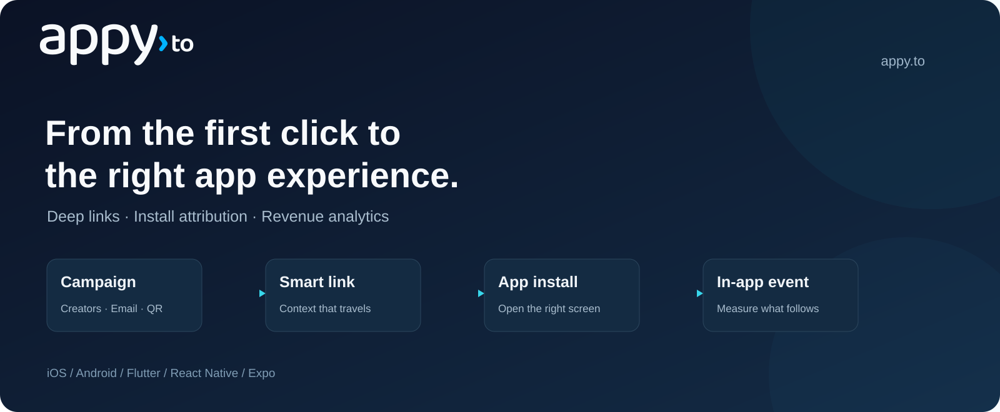

# Appy Android SDK



Deep links, install attribution and in-app events for your Android app.

**1.0.0** · Android API 21+ · [MIT](LICENSE)

[Step-by-step setup](QUICKSTART.md) · [Your dashboard values](SETUP.md) · [API reference](#api-reference) · [Support](mailto:support@appy.to)

## Quick start

### 1. Get your app's key and domain

In the [Appy dashboard](https://appy.to), open **Apps & SDK → New app**. Register your own app, then copy **Publishable key** and **Link domain** from **SDK setup**. The hosted SDK features require an Enterprise plan.

Replace `YOUR_PUBLISHABLE_KEY` and `your-app.appy.to` below with those two values. Keep the SDK/package names as written. [Help finding your values](SETUP.md).

### 2. Install

Add the SDK from [Maven Central](https://central.sonatype.com/artifact/to.appy/appy-sdk/1.0.0) to your app module's `build.gradle.kts`:

```kotlin
dependencies {
    implementation("to.appy:appy-sdk:1.0.0")
}
```

Ensure both `google()` and `mavenCentral()` are in your dependency repositories. Gradle resolves the SDK's dependencies automatically. [Requirements and manual AAR installation](#requirements-and-installation).

### 3. Configure and connect links

Import `Appy` and `AppyConfig` from `to.appy.sdk`. In your `Application.onCreate()`, after `super.onCreate()`:

```kotlin
Appy.init(this, AppyConfig(
    "YOUR_PUBLISHABLE_KEY",
    listOf("your-app.appy.to")
))
```

Finish the required Android setup: [add the App Link intent filter](#intent-filters), then [receive deep links](#receive-deep-links) and [forward links received while the app is open](#handle-incoming-intents).

### 4. Test your first link

Create a link for this dashboard app, install the matching app build and tap the link. Confirm that your deep-link handler receives it before testing fresh installs or adding event tracking. [Follow the complete walkthrough](QUICKSTART.md).

---

## Detailed guide

The sections below cover platform settings, callbacks, events, consent, troubleshooting and the API. Start here when you need a specific integration detail.

<details>
<summary>Browse the detailed guide</summary>

1. [Requirements and installation](#requirements-and-installation)
2. [Register your app](#register-your-app)
3. [Intent filters](#intent-filters)
4. [Initialise](#initialise)
5. [Handle incoming intents](#handle-incoming-intents)
6. [Receive deep links](#receive-deep-links)
7. [Deferred deep linking](#deferred-deep-linking)
8. [Install attribution](#install-attribution)
9. [Track events](#track-events)
10. [User id, privacy and opt-out](#user-id-privacy-and-opt-out)
11. [Share links](#share-links)
12. [Debugging](#debugging)
13. [Lightweight by design](#lightweight-by-design)
14. [API reference](#api-reference)
15. [For maintainers](#for-maintainers)
16. [Third-party licensing](#third-party-licensing)

</details>

## Requirements and installation

- Android 5.0 (API 21) or newer, Java 8 compatible bytecode. Kotlin projects need Kotlin 2.0-compatible tooling (this release is built with Kotlin 2.0.21). Java projects work too; every example below has a Java version.
- An app registered with Appy on the Enterprise plan. Keys on other plans receive `403 plan_required`.
- A publishable key (`appy_pk_...`). Never put a secret key (`appy_sk_...`) in an app.

Add the SDK from Maven Central in your app module's `build.gradle.kts`:

```kotlin
dependencies {
    implementation("to.appy:appy-sdk:1.0.0")
}
```

Ensure both `google()` and `mavenCentral()` are present in your dependency repositories. Gradle resolves the Google Install Referrer and Kotlin standard library dependencies automatically.

A [manual AAR download](https://github.com/appy-to/appy-android-sdk/releases/tag/1.0.0) is also available. Local AAR integrations must declare `com.android.installreferrer:installreferrer:2.2` and `org.jetbrains.kotlin:kotlin-stdlib:2.0.21` explicitly.

No ProGuard or R8 rules are needed. The manifest merges `android.permission.INTERNET` and two `<queries>` entries, which keep the Play Store's install referrer service and AppGallery's attribution provider visible on Android 11 and newer:

```xml
<queries>
    <package android:name="com.android.vending" />
    <provider android:authorities="com.huawei.appmarket.commondata" />
</queries>
```

## Register your app

Open **Apps & SDK → New app** in the [Appy dashboard](https://appy.to). Use your own app's name, choose its link subdomain, enable Android, and enter your **Package name** and **SHA-256 certificate fingerprints**.

| Field | Where to find your value |
| --- | --- |
| Package name | The `applicationId` in your app module's Gradle configuration |
| Fingerprint for Play Store builds | Play Console → your app → App integrity → App signing → **App signing key certificate** |
| Fingerprint for a debug build | Run `./gradlew :app:signingReport` in your Android project and copy the debug SHA-256 |
| Fingerprint for another signed build | Use the certificate that signs the build your users actually install |

Play App Signing uses Google's app signing certificate. Include that certificate for Play builds, even if your debug build already works.

Select **Register app**. On that app's page, open **SDK setup** and copy the **Publishable key** and **Link domain**. If the same product also runs on iOS, add iOS to the same dashboard app.

Replace `YOUR_PUBLISHABLE_KEY` and `your-app.appy.to` in the examples with those two dashboard values. Keep `Appy`, `AppyConfig` and `to.appy.sdk`: these are library names, not your app's name or package ID. [See the value-by-value explanation](SETUP.md).

Appy publishes the domain-verification file for you. The next step lets Android associate that domain with your app. No `curl` command or secret API key is needed for this flow. Server-side registration automation is documented separately in the [developer API reference](https://api.appy.to/docs).

## Intent filters

```xml
<activity
    android:name=".MainActivity"
    android:exported="true"
    android:launchMode="singleTask">

    <intent-filter>
        <action android:name="android.intent.action.MAIN" />
        <category android:name="android.intent.category.LAUNCHER" />
    </intent-filter>

    <intent-filter android:autoVerify="true">
        <action android:name="android.intent.action.VIEW" />
        <category android:name="android.intent.category.DEFAULT" />
        <category android:name="android.intent.category.BROWSABLE" />
        <data android:scheme="https" />
        <data android:host="your-app.appy.to" />
    </intent-filter>

    <intent-filter>
        <action android:name="android.intent.action.VIEW" />
        <category android:name="android.intent.category.DEFAULT" />
        <category android:name="android.intent.category.BROWSABLE" />
        <data android:scheme="yourapp" />
    </intent-filter>
</activity>
```

- The `autoVerify` filter is the App Link: once verified, taps on `https://your-app.appy.to/...` open the app instead of the browser. It matches the whole host because Appy links are `https://your-app.appy.to/<slug>`.
- The custom scheme is the fallback for in-app browsers (Instagram, Facebook, some mail apps) that never hand links to Android. Appy's page then opens `yourapp://...?appy_click_id=...`, which the SDK recognises by `appy_click_id`. Custom-scheme URLs without it are left to your code. The same filter lets the SDK open deferred deep links for you (see [`openDeferredDeepLinks`](#open-deferred-deep-links-automatically)).
- With `singleTask` or `singleTop`, links that arrive while the app runs go to `onNewIntent`; with `standard`, Android creates a new activity and the SDK picks the intent up automatically.

## Initialise

Kotlin:

```kotlin
class YourApplication : Application() {
    override fun onCreate() {
        super.onCreate()
        Appy.init(this, AppyConfig("YOUR_PUBLISHABLE_KEY", listOf("your-app.appy.to")).apply {
            logLevel = if (BuildConfig.DEBUG) AppyLogLevel.DEBUG else AppyLogLevel.ERROR
        })
    }
}
```

Java:

```java
public class YourApplication extends Application {
    @Override
    public void onCreate() {
        super.onCreate();
        AppyConfig config = new AppyConfig("YOUR_PUBLISHABLE_KEY", Collections.singletonList("your-app.appy.to"));
        config.setLogLevel(BuildConfig.DEBUG ? AppyLogLevel.DEBUG : AppyLogLevel.ERROR);
        Appy.init(this, config);
    }
}
```

`AppyConfig(publishableKey, linkDomains)` takes the two values every app needs; everything else is a property with a default:

| `AppyConfig` | Default | Meaning |
|---|---|---|
| `publishableKey` | required | `appy_pk_...`; another prefix is logged as an error. |
| `linkDomains` | empty | Hosts whose URLs are Appy links, matched exactly and case-insensitively. The first one is used by `buildLink`. |
| `emailLinkDomains` | empty | Click-tracking domains of your email tool that open the app. See [Links in marketing email](#links-in-marketing-email). |
| `logLevel` | `ERROR` | `NONE`, `ERROR`, `WARNING`, `INFO`, `DEBUG`; Logcat tag `Appy`. |
| `openDeferredDeepLinks` | `false` | Let the SDK open a deferred link's in-app deep link itself (see [below](#open-deferred-deep-links-automatically)). |
| `deferredDeepLinkTimeoutMillis` | `5000` | How long the first launch waits for its deep link answer before the listener receives `Failed(AppyError.TIMEOUT)`. |
| `launchLinkWaitMillis` | `500` | How long the launch open waits for a link, so a cold start from a link sends one request instead of two. |
| `requestTimeoutMillis` | `10000` | Connect and read timeout of each HTTP attempt. |
| `collectInstallReferrer` | `true` | Read the install referrer of the store that installed the app on the first launch. |
| `apiBaseUrl` | `https://api.appy.to` | Change only for a staging API. |

`init` reads the configuration once, loads the SDK state from the private `SharedPreferences` file `to.appy.sdk` (a random install id, whether the first launch was reported, the install attribution, the tracking preference, the user id and queued events), registers `ActivityLifecycleCallbacks`, and starts the launch open. A second call logs a warning and does nothing.

## Handle incoming intents

Nothing is needed in `onCreate`: when an activity is created without saved state, the SDK inspects its intent. An `ACTION_VIEW` intent whose host is one of `linkDomains`, or whose URL has an `appy_click_id` parameter, is resolved; anything else is ignored and nothing is sent. Forward `onNewIntent`, which lifecycle callbacks cannot see:

```kotlin
override fun onNewIntent(intent: Intent) {
    super.onNewIntent(intent)
    setIntent(intent)
    if (!Appy.handleIntent(intent)) legacyRouter.handle(intent)
}
```

- `handleIntent` returns `true` for an Appy link. The SDK marks the intent with the extra `to.appy.sdk.handled` and never processes it twice; intents Android replays from Recents are not processed either, so old links do not reopen.
- `Appy.handleUri(uri)` resolves a URL that did not arrive as an intent, such as a push payload or an in-app QR scan.
- Before `init` the SDK cannot know your link domains: it keeps up to 10 URLs, returns `true` for any `http`/`https` URL or URL with `appy_click_id`, and after `init` resolves the Appy links among them as the launch link and drops the rest.

### Links in push notifications and in-app messages

A link in a push notification or an in-app message reaches your code as a URL, not as a link intent. Pass it to `Appy.handleUri` where your messaging library reports the tap:

```kotlin
fun onMessageLinkTapped(url: String) {
    if (!Appy.handleUri(Uri.parse(url))) router.openUrl(url)
}
```

```java
void onMessageLinkTapped(String url) {
    if (!Appy.handleUri(Uri.parse(url))) router.openUrl(url);
}
```

An Appy link goes to your deep link listener as `Found` with `isDeferred = false`, and Appy counts it as an app open for that link, the same as a link that opens the app. `handleUri` returns `false` for any other URL, which stays yours to handle. For a notification, call it once for the tap, not again when the activity is recreated.

### Links in marketing email

Email tools wrap every link in a click-tracking URL on their own domain. When that domain serves an `assetlinks.json` file for your app and your manifest has a verified intent filter for it, a tap opens the app with the tracking URL, not with your link. List the domain in `emailLinkDomains`; launch intents and `handleIntent` pick these links up like any other:

```kotlin
val config = AppyConfig("YOUR_PUBLISHABLE_KEY", listOf("your-app.appy.to")).apply {
    emailLinkDomains = listOf("links.example.com")
}
```

- The SDK requests the tracking URL once with `instanceFollowRedirects = false` and reads its `Location` header, the way SendGrid documents it, so your email tool counts the click. It keeps going only while the redirects stay on your email link domains, for at most 5 requests.
- An Appy link behind it is resolved like any other: `Found` with its slug, one open request, and on a cold start it is the launch link.
- Any other destination reaches your listener as `Found` with that `url`, an empty `slug` and the URL's query parameters. Route it yourself.
- When the email tool cannot be reached or does not redirect, `Found` carries the tracking URL itself and an empty `slug`.
- With SendGrid, the intent filter for the tracking domain needs the path prefix `/uni/`. Klaviyo's tracking domains need Klaviyo's own SDK.

The [AASA generator](https://appy.to/tools/aasa-assetlinks-generator?host=sendgrid) has presets for SendGrid, Braze and Klaviyo tracking domains, and the [validator](https://appy.to/tools/universal-link-validator?mode=email) traces a link from a test email.

## Receive deep links

One listener receives every deep link, deferred or not, as an `AppyDeepLinkResult`:

| Result | When |
|---|---|
| `Found(link)` | An Appy link opened the app (`link.isDeferred` is `false`), or on the first launch after install, Appy matched the install to the link the user tapped before installing (`link.isDeferred` is `true`). |
| `NotFound` | The first launch has no link: the install did not come from an Appy link. |
| `Failed(error)` | The first launch got no usable answer: `AppyError.TIMEOUT` (nothing within `deferredDeepLinkTimeoutMillis`), `NETWORK` (Appy could not be reached after three attempts) or `INVALID_RESPONSE` (Appy answered with an error such as an invalid key, which the log shows, or with something the SDK could not read). |

Kotlin:

```kotlin
Appy.setDeepLinkListener { result ->
    when (result) {
        is AppyDeepLinkResult.Found -> {
            val link = result.link
            if (link.slug == "spring") router.openProduct(link.parameters["item"])
            else link.deeplinkUri?.let(router::open) ?: router.openHome()
        }
        AppyDeepLinkResult.NotFound, is AppyDeepLinkResult.Failed -> router.openHome()
    }
}
```

Java:

```java
Appy.setDeepLinkListener(result -> {
    if (result instanceof AppyDeepLinkResult.Found) {
        AppyDeepLink link = ((AppyDeepLinkResult.Found) result).getLink();
        router.openProduct(link.getParameters().get("item"));
    } else {
        router.openHome();
    }
});
```

What the listener can rely on:

- It is always called on the main thread.
- On the first launch after install it is called exactly once, with `Found`, `NotFound` or `Failed`, at the latest `deferredDeepLinkTimeoutMillis` (5 s by default) after `init`. An answer that arrives later is not delivered as a second result; it still updates the [install attribution](#install-attribution). If the first launch itself came from an Appy link and the answer is late, that link is delivered as `Found`, read from its own URL.
- After that, it is called with `Found` for every Appy link that opens the app. Later cold starts without a link do not call it.
- If no listener is set when a result arrives, the most recent result waits and is delivered once, when a listener is set. A listener that captures an activity should be cleared in `onDestroy` with `Appy.setDeepLinkListener(null)`; a result arriving meanwhile waits for the next listener.
- `Appy.latestDeepLink` returns the last link delivered in this process, or `null`.

| `AppyDeepLink` | Meaning |
|---|---|
| `url: Uri?` | The Appy link that was opened or tapped. |
| `deeplinkUri: Uri?` | The in-app deep link configured on the link, such as `yourapp://items?item=42`; with parameter forwarding, the click's query parameters are merged in. |
| `slug: String` | The link's slug in Appy. |
| `parameters: Map<String, String>` | Query parameters of the tapped link, first value per name, without the reserved `appy_` ones. |
| `isDeferred: Boolean` | `true` when the link was tapped before the app was installed. |
| `clickedAt: Long?` | Tap time in epoch milliseconds, when known. |

If Appy cannot be reached after three attempts, or answers without a link, a link that opened the app is still delivered as `Found`, read from its own URL: `slug` is the first path segment on a link domain (empty otherwise), `parameters` the query without `appy_` names, and no `deeplinkUri` or `clickedAt`. URLs longer than 2048 bytes are always handled this way.

## Deferred deep linking

1. Someone taps `https://your-app.appy.to/spring?item=42` without the app installed.
2. Appy records the tap and opens your Google Play or AppGallery listing, passing the link along in the store's install referrer.
3. On the first launch after install the SDK reads the referrer from the store that installed the app (waiting at most 3 s) and sends it with the launch open.
4. Appy matches the install to the link, and the listener receives `Found` with `isDeferred = true`, the same `slug`, `parameters` and `deeplinkUri` as a direct open.

What to expect:

- Installs from Google Play or AppGallery that started from the link carry the link in the store's install referrer, so Appy knows exactly which link it was.
- For installs from other stores, sideloads, or when the user searched the store instead of following the link, Appy still matches the install to the link when it can. [Strict attribution](#strict-attribution) turns this off.
- Only the first launch is matched. The SDK reports `firstLaunch = true` until one first-launch open has succeeded, and Appy answers a retried first launch with the same result. If the first launch's request fails, the next cold start is reported as the first launch again, so the link can still arrive then.

Every open reports the package name of the store that installed the app as `app.installer`, from `InstallSourceInfo.getInstallingPackageName()` on Android 11 and newer and `PackageManager.getInstallerPackageName()` before. It is left out when Android does not know the installer, for example after `adb install`. On the first launch the installer decides where the referrer comes from:

| Installer | Referrer read on the first launch | `installReferrerSource` |
|---|---|---|
| `com.huawei.appmarket` (Huawei AppGallery) | AppGallery's attribution provider, then the Play Install Referrer if AppGallery returns nothing | `huawei_appgallery`, or `google_play` after the fallback |
| `com.android.vending`, any other store, or unknown | the Play Install Referrer | `google_play` |

The referrer is sent unmodified as `installReferrer`, with the store it came from as `installReferrerSource`. All sources share the 3 s budget; when none answers in time, the open is sent without a referrer.

- AppGallery: the SDK queries `content://com.huawei.appmarket.commondata/item/5` with your package name and reads the referrer set in the AppGallery link, which needs AppGallery 10.5.0.300 or newer. AppGallery keeps it for 90 days and loses it when the user clears AppGallery's data. No HMS Core is involved; the query runs on a short-lived background thread. Huawei's attribution guide notes that the query talks to AppGallery and may count as launching it, and asks apps to mention this in their privacy policy and to query only after consent; keep `Appy.isTrackingEnabled` off until the user agrees, and the SDK queries only then.
- Samsung Galaxy Store, Xiaomi GetApps, vivo, RuStore and other stores: their referrer interfaces need a vendor SDK or are not publicly documented, so no referrer is read. The installer is still reported.

### Open deferred deep links automatically

With `openDeferredDeepLinks = true`, when the first launch receives `Found` with `isDeferred = true` and the link has a `deeplinkUri`, the SDK calls your listener and then starts an `ACTION_VIEW` intent for that URI, restricted to your own package so it never opens another app or the browser. The activity whose intent filter matches (the custom-scheme filter above) receives it, in `onCreate` or, with `singleTask`, in `onNewIntent`. It happens even when no listener is set yet.

```kotlin
AppyConfig("YOUR_PUBLISHABLE_KEY", listOf("your-app.appy.to")).apply { openDeferredDeepLinks = true }
```

```java
config.setOpenDeferredDeepLinks(true);
```

Links that opened the app directly are never reopened, and neither is a deferred link whose answer came after `deferredDeepLinkTimeoutMillis`. Route deferred links either in your listener or through this intent, not both.

### Keep the first launch a first launch

Android Auto Backup restores `SharedPreferences` on reinstall and on new phones, which makes a new install look old (no first launch, so no deferred link). Exclude the SDK's file. `res/xml/backup_rules.xml` (Android 11 and lower):

```xml
<full-backup-content>
    <exclude domain="sharedpref" path="to.appy.sdk.xml" />
</full-backup-content>
```

`res/xml/data_extraction_rules.xml` (Android 12 and newer):

```xml
<data-extraction-rules>
    <cloud-backup>
        <exclude domain="sharedpref" path="to.appy.sdk.xml" />
    </cloud-backup>
    <device-transfer>
        <exclude domain="sharedpref" path="to.appy.sdk.xml" />
    </device-transfer>
</data-extraction-rules>
```

Reference both from `<application android:fullBackupContent="@xml/backup_rules" android:dataExtractionRules="@xml/data_extraction_rules">`, or add the `exclude` lines to your existing rules.

## Install attribution

On the first launch Appy also tells the app which link brought the install, or that the install is organic. [How attribution works](https://appy.to/docs/attribution) explains how Appy matches installs to links and what it stores.

Kotlin:

```kotlin
Appy.setAttributionListener { attribution ->
    analytics.setUserProperty("install_campaign", if (attribution.isOrganic) "organic" else attribution.campaign)
}

val installedFrom: String? = Appy.attribution?.linkSlug
```

Java:

```java
Appy.setAttributionListener(attribution ->
    analytics.setUserProperty("install_campaign", attribution.isOrganic() ? "organic" : attribution.getCampaign()));

AppyAttribution attribution = Appy.getAttribution();
```

| `AppyAttribution` | Meaning |
|---|---|
| `isOrganic: Boolean` | `true` when the install did not come from an Appy link; every other field is then `null`. |
| `linkSlug: String?`, `linkTitle: String?` | The link that brought the install. |
| `source: String?`, `medium: String?`, `campaign: String?` | The `utm_source`, `utm_medium` and `utm_campaign` parameters of the tapped link, when it had them. |
| `clickedAt: Long?` | Tap time in epoch milliseconds, when known. |
| `network: AppyAdNetwork?` | Set when Google Ads or Meta attributed the install instead of an Appy link: `name` (`google_ads` or `meta`), `campaignId`, `campaignName`, `adGroupId`, `adGroupName`, `adId`, `clickId` (the Google Ads `gclid`) and `touch` (`click` or `view`). `linkSlug` is then `null`. |

- The attribution listener is called once, on the main thread, when the first launch's answer arrives, also when that answer came too late for the deep link listener. A listener set later still receives it.
- `Appy.attribution` keeps the value in the SDK's storage and returns it on every later launch, right after `init`. It is `null` until the first answer has arrived.

### Google Ads and Meta installs

Installs from ads that never touched an Appy link are attributed from the network's own data, with no extra code for Google Ads:

- **Google Ads:** a `gclid` in the Play install referrer marks the install as Google Ads.
- **Meta (Facebook, Instagram):** set your Facebook App ID and paste the Install Referrer Decryption Key (Meta App Dashboard → App settings → Basic → Android) into your app's settings in the Appy dashboard. On the first launch the SDK reads the Meta Install Referrer from the Facebook, Instagram or Facebook Lite app and Appy decrypts the campaign, ad set and ad on the server.

```kotlin
Appy.init(this, AppyConfig("YOUR_PUBLISHABLE_KEY", listOf("your-app.appy.to")).apply {
    metaAppId = "1234567890"
})
```

The SDK's manifest already declares the `<queries>` entries for those three apps. An Appy link match always wins over network data.

### Strict attribution

Strict attribution is an app setting on your app's page in the Appy dashboard, not something you set in code: only count installs Appy can verify; everything else is organic. Appy can verify an install when the store's install referrer carried the link, or when the link itself opened the app. With it on, other first launches receive `NotFound` and an organic attribution. It is off by default.

### Rewards and anything of value

Route users on any `Found` link, but confirm on your server before granting referral rewards, invites, discounts or account access. Call `Appy.setUserId` after sign-in. Your backend can then check the install through the [server attribution API](https://api.appy.to/docs). That check runs on your server with a server credential; it is not mobile SDK setup.

Grant the reward only when the install's `attribution.verified` is `true`.

## Track events

```kotlin
Appy.track("signup")
Appy.track("purchase", mapOf("sku" to "A1", "qty" to 2, "gift" to false), revenue = 19.98, currency = "USD")
```

```java
Map<String, Object> properties = new HashMap<>();
properties.put("sku", "A1");
properties.put("qty", 2);
Appy.track("signup");
Appy.track("purchase", properties, 19.98, "USD");
```

`track` returns immediately and never throws for invalid input; what it drops is logged:

- The name is trimmed and must be 1 to 64 printable characters, otherwise the event is dropped.
- Property values must be `String`, `Number` or `Boolean`; at most 50 properties with keys of 1 to 64 characters; strings are cut at 512 characters.
- `revenue` needs a finite amount below 10^12 and a 3-letter ISO 4217 `currency` (upper-cased for you); otherwise both are dropped and the event is kept.
- `deduplicationId` is trimmed and must be 1 to 128 printable ASCII characters without spaces; otherwise the problem is logged as an error and the event is kept with a generated id.

Events get a unique id (your `deduplicationId` when you pass one), a UTC timestamp and the current user id, are stored on disk (at most 1000, oldest dropped first), and are sent in batches of up to 100 events and 256 KB: 2 s after the last `track`, at once when 20 are waiting, when the app goes to the background, and on `Appy.flush()`, but never before the launch open has finished. Network errors, `429` and `5xx` keep the events and retry with growing delays (4 s, 8 s, ... up to 5 minutes, or the server's `Retry-After`). Other `4xx` responses drop the batch with an error log, and events the server rejects individually inside an accepted batch are logged as warnings. Appy de-duplicates by event id, so resending is safe. Up to 100 `track` calls made before `init` are kept with their original time.

### Count a purchase once

The same purchase can be tracked twice: again after a crash or a restore, or once from the app and once from your backend. Pass the store's transaction id as `deduplicationId` and Appy counts it once. With Google Play Billing, that is the order id of a purchase in the `PURCHASED` state:

```kotlin
Appy.track("purchase", mapOf("sku" to "A1"), revenue = 19.98, currency = "USD", deduplicationId = purchase.orderId)
```

```java
Map<String, Object> properties = new HashMap<>();
properties.put("sku", "A1");
Appy.track("purchase", properties, 19.98, "USD", purchase.getOrderId());
```

If your backend also sends the purchase as a server event through `POST /v1/apps/{appId}/events`, pass the same order id as the event's `id`, and Appy counts the purchase once. The id is unique per app across the app and your backend, so use one per purchase, not per product. While an event with the same `deduplicationId` is still waiting to be sent, a second one is dropped with an info log; one tracked after that is sent, and Appy ignores it as a duplicate.

## User id, privacy and opt-out

`Appy.setUserId("u_123")` stores an opaque id from your system and attaches it to later opens and events; `Appy.setUserId(null)` clears it at logout. Ids are trimmed and may have up to 128 characters; a longer one is rejected and the stored id is cleared. Do not use an email address or phone number.

The SDK sends: the install id (a random UUID in app-private storage, reset when app data is cleared), the Appy link URL that opened the app, the raw install referrer and the store it came from (first launch only), the user id if set, device platform, OS version, model and locale, and the app's package name, version name, version code and installing store's package name, plus the events you track. It does not read the advertising ID (no `AD_ID` permission needed), Android ID, hardware identifiers, location, contacts, installed apps or clipboard. All requests use HTTPS.

`Appy.isTrackingEnabled = false` is stored across restarts. While it is off, queued events are deleted and new ones dropped, and no launch open, install referrer read or deferred deep link lookup happens, so the first-launch result waits. Links that open the app still resolve: the SDK sends the URL with `trackingEnabled: false` and without the user id, and Appy stores nothing about that open. Setting it back to `true` sends the launch open that was skipped in this process, with the install referrer on a first launch.

For the Play Data safety form, consider "Device or other IDs" (the install id), "App activity" (opens and events), "User IDs" (if you call `setUserId`) and "Purchase history" (if you track revenue), with purposes such as Analytics and App functionality, encrypted in transit. Your answers depend on your own use of the data. [Privacy labels](https://appy.to/docs/sdk/privacy-labels) lists the answers for Google Play and App Store Connect with strict and standard attribution, and [How attribution works](https://appy.to/docs/attribution) lists what Appy stores and for how long.

### Waiting for consent

If the user has to agree first, set `Appy.isTrackingEnabled = false` before `Appy.init`, because `init` starts the launch open right away, and set it to `true` once the user agrees:

```kotlin
class YourApplication : Application() {
    override fun onCreate() {
        super.onCreate()
        Appy.isTrackingEnabled = consentStore.hasAnalyticsConsent()
        Appy.init(this, appyConfig)
    }
}

fun onAnalyticsConsentGiven() {
    consentStore.setAnalyticsConsent(true)
    Appy.isTrackingEnabled = true
}
```

```java
Appy.setTrackingEnabled(consentStore.hasAnalyticsConsent());
Appy.init(this, config);
```

```java
void onAnalyticsConsentGiven() {
    consentStore.setAnalyticsConsent(true);
    Appy.setTrackingEnabled(true);
}
```

- Nothing is sent before consent: no launch open, no install referrer read, no events. Events tracked meanwhile are dropped, not held. A link that opens the app still resolves, untracked, as described above.
- When it turns `true`, the first-launch lookup starts: the SDK reads the install referrer, sends the launch open, and the deep link listener receives the first-launch result within `deferredDeepLinkTimeoutMillis`, counted from that moment. Consent given on the first screen still yields the deferred link.
- The value is stored, so this also works when the user agrees only on a later launch: the first-launch lookup waits until then.

### Deleting a user's data

The SDK has no delete call, because your backend owns the relationship with the user. To erase one person's data, call `DELETE /v1/apps/{appId}/installs?userId=<id>` from your backend with a secret key: it deletes every install with that user id, their events, and your server events for that user. It finds installs by the id you passed to `Appy.setUserId`, and deleting is permanent. See the [REST API](https://appy.to/docs/api).

## Share links

```kotlin
val url: Uri? = Appy.buildLink("spring", mapOf("item" to "42"))
```

The result is `https://your-app.appy.to/spring?item=42`: the first link domain, the slug lower-cased and matching `[a-z0-9-]{1,64}`, parameters sorted and percent-encoded. It is `null` before `init`, without a link domain or for an invalid slug. The slug must belong to an existing link; nothing is created on the server.

## Debugging

- Set `logLevel = AppyLogLevel.DEBUG` and run `adb logcat -s Appy`. The SDK logs each request, retry, the install referrer, each deep link and attribution it delivers, and why anything was dropped. The key is only logged as its first 12 characters.
- Verification state (Android 12 and newer): `adb shell pm get-app-links com.example.yourapp` should show `your-app.appy.to: verified`. After fixing the file or fingerprints: `adb shell pm verify-app-links --re-verify com.example.yourapp`.
- What Google sees: `curl "https://digitalassetlinks.googleapis.com/v1/statements:list?source.web.site=https://your-app.appy.to&relation=delegate_permission/common.handle_all_urls"`.
- Open a link (quote the command so `&` reaches the device), once with the app stopped and once in the foreground:

```bash
adb shell 'am start -W -a android.intent.action.VIEW -c android.intent.category.BROWSABLE -d "https://your-app.appy.to/spring?item=42&utm_source=adb"'
adb shell 'am start -W -a android.intent.action.VIEW -d "yourapp://items/42?appy_click_id=test123" com.example.yourapp'
```

- Deferred deep links: see [Testing deferred deep links](#testing-deferred-deep-links) below.

| Symptom | Check |
|---|---|
| Links open the browser | `pm get-app-links`, the fingerprint of the certificate that signed the installed build, `autoVerify`, `assetlinks.json` served without redirect, in-app browsers (custom scheme fallback). |
| Listener never called | `init` in `Application.onCreate`, the domain in `linkDomains`, `onNewIntent` forwarded, `appy_click_id` on custom-scheme URLs, `isTrackingEnabled` off on the first launch. |
| `Failed(INVALID_RESPONSE)` | `HTTP 401` or `403` in the log: the publishable key, or a plan without the SDK. |
| `Failed(TIMEOUT)` | A slow or missing connection on the first launch; `deferredDeepLinkTimeoutMillis` can be raised. |
| `NotFound` on a test install | Only the first launch is matched (`pm clear` repeats it); `Install referrer from` in the log; the installer shown by `dumpsys package`; for AppGallery, AppGallery 10.5.0.300 or newer and a `referrer` in the AppGallery link; strict attribution in the dashboard. |
| Deferred link not opened | `openDeferredDeepLinks`, a `deeplinkUri` on the link, an intent filter in your app that matches it (the log says when none does). |
| Events missing | `isTrackingEnabled` is `false`, or the log shows rejected events. |
| Local backend unreachable | Android blocks cleartext HTTP by default; use HTTPS or a debug network security config. |

### Testing deferred deep links

1. Uninstall the app from the phone.
2. On the same phone, tap an Appy link, for example in a message to yourself. It opens the store listing or your fallback page; you do not need to install from there.
3. Install your build: `adb install`, Run in Android Studio, or an internal testing track in Play.
4. Open the app. The deep link listener receives `Found` with `isDeferred = true`.

Every install gets a new random install id, so there is no test device to register and nothing to reset on the server. To test again, repeat the steps: each tap is a new click. This relies on the SDK's file being excluded from Auto Backup ([Keep the first launch a first launch](#keep-the-first-launch-a-first-launch)); otherwise a reinstall can bring the old state back and skip the first launch.

An install from the Play listing the link opened also carries the link in the Play install referrer. A build installed with adb or Android Studio does not, so a local test goes through the same matching as installs from other stores and sideloads, and with [strict attribution](#strict-attribution) on it gets `NotFound`. To test the referrer, install from the listing the link opens, on an internal testing track in Play or on AppGallery (AppGallery 10.5.0.300 or newer); both stores keep the referrer for 90 days.

With `logLevel = AppyLogLevel.DEBUG`, `adb logcat -s Appy` shows each step: `Install referrer from` with the referrer or `unavailable`, `Sending open: firstLaunch=true`, then `Deep link: slug=spring, deferred=true` and the install attribution. `adb shell dumpsys package com.example.yourapp | grep installerPackageName` shows the store Android recorded as the installer.

## Lightweight by design

The SDK uses the Kotlin standard library and Google Play Install Referrer. It does not require Play Services, HMS Core or a networking library. Network requests and event delivery run in the background.

The release AAR contains Appy code; a local AAR does not include its external dependencies. Follow the dependency list in [Requirements and installation](#requirements-and-installation). For data collection and consent controls, see [User id, privacy and opt-out](#user-id-privacy-and-opt-out).

## API reference

| `Appy` member | Description |
|---|---|
| `SDK_VERSION` | `"1.0.0"`, also sent as `X-Appy-SDK: android/1.0.0`. |
| `init(context, config)` | Call once from `Application.onCreate`. |
| `setDeepLinkListener(listener)` | Sets or clears the main-thread `AppyDeepLinkListener`. |
| `setAttributionListener(listener)` | Sets or clears the main-thread `AppyAttributionListener`. |
| `latestDeepLink: AppyDeepLink?` | Last link delivered in this process. |
| `attribution: AppyAttribution?` | The install attribution, kept across launches. |
| `handleIntent(intent): Boolean` | Resolves the Appy link in an `ACTION_VIEW` intent. |
| `handleUri(uri): Boolean` | Resolves an Appy link URL received another way. |
| `track(name, properties = emptyMap(), revenue = null, currency = null, deduplicationId = null)` | Queues an event. |
| `setUserId(userId)` | Sets or clears the user id. |
| `isTrackingEnabled` | Stored opt-out switch, default `true`. |
| `buildLink(slug, parameters = emptyMap()): Uri?` | Builds a share link. |
| `flush()` | Sends queued events now. |

| Type | Description |
|---|---|
| `AppyConfig` | `AppyConfig(publishableKey, linkDomains)` plus the properties in [Initialise](#initialise). |
| `AppyDeepLinkListener` | `fun interface` with `onDeepLink(result: AppyDeepLinkResult)`, usable as a lambda from Kotlin and Java. |
| `AppyDeepLinkResult` | Sealed class: `Found(link: AppyDeepLink)`, `NotFound` (in Java `AppyDeepLinkResult.NotFound.INSTANCE`), `Failed(error: AppyError)`. |
| `AppyDeepLink` | Data class described in [Receive deep links](#receive-deep-links). |
| `AppyError` | `TIMEOUT`, `NETWORK`, `INVALID_RESPONSE`. |
| `AppyAttributionListener` | `fun interface` with `onAttribution(attribution: AppyAttribution)`. |
| `AppyAttribution` | Data class described in [Install attribution](#install-attribution). |
| `AppyLogLevel` | `NONE`, `ERROR`, `WARNING`, `INFO`, `DEBUG`. |

Every public method is safe to call from any thread and returns immediately. The SDK talks only to `POST /v1/sdk/open` and `POST /v1/sdk/events`, with `Authorization: Bearer <publishableKey>`.

## For maintainers

`sdks/android` is a standalone Gradle 8.7 project (Android Gradle Plugin 8.5.2, Kotlin 2.0.21, JDK 17). Kotlin warnings fail the build and `explicitApi()` is on.

```bash
./gradlew clean :appy-sdk:assembleRelease :appy-sdk:testDebugUnitTest :appy-sdk:lint
```

The release AAR is `appy-sdk/build/outputs/aar/appy-sdk-release.aar`; hand it out as `appy-sdk-<version>.aar`. The Android-facing code lives in `internal/AndroidPlatform.kt` and the `Uri` conversion in `Appy.kt`; everything else runs on the JVM in unit tests through small seams (`Scheduler`, `Store`, `Transport`, `ReferrerSource`, `MainPoster`, and `Services.openUrl` for opening deferred links). `internal/InstallSource.kt` maps the installer to the ordered referrer sources; supporting another store means a `ReferrerSource` for it in `AndroidPlatform.kt`, a branch in `InstallSource.referrerSources()`, a `<queries>` entry in the manifest and tests in `InstallSourceTest`.

The dex numbers above come from R8 9.0.3 (Android build-tools 36.1.0) at min SDK 21, keeping every public class of `to.appy.sdk`:

```bash
echo '-keep public class to.appy.sdk.* { public *; }' > keep.pro && echo '-dontwarn **' >> keep.pro
java -cp $ANDROID_HOME/build-tools/36.1.0/lib/d8.jar com.android.tools.r8.R8 --release --min-api 21 \
  --output out --pg-conf keep.pro --lib $ANDROID_HOME/platforms/android-34/android.jar --lib kotlin-stdlib-2.0.21.jar \
  aar/classes.jar installreferrer-2.2/classes.jar
```

To release: set `appy.version` in `gradle.properties` (it also sets `Appy.SDK_VERSION`) and update `CHANGELOG.md`. The Maven coordinates and the POM's project and SCM URLs are the other `appy.*` properties in the same file. The POM declares the MIT license.

- `./gradlew :appy-sdk:publishReleasePublicationToLocalRepository` writes the AAR, sources and javadoc jars and the POM to `build/local-maven`. The Flutter and React Native wrappers read it while their `native-sdk.json` says `"source": "local"`.
- `./gradlew :appy-sdk:centralBundle` signs the publication with the key in `APPY_SIGNING_KEY` (ASCII-armored, with `APPY_SIGNING_PASSWORD` and optionally `APPY_SIGNING_KEY_ID`) and zips it in the Maven Central layout to `build/distributions/appy-sdk-<version>-central-bundle.zip`. Keys live in CI secrets or the release machine's keychain, never in the repository.
- `sdks/scripts/publish-android-central.sh` runs the tests, lint and `centralBundle`, then uploads the bundle to the Central Portal with the user token in `CENTRAL_TOKEN_USERNAME` and `CENTRAL_TOKEN_PASSWORD`. Press **Publish** in the portal once the deployment is validated.

The private monorepo release guide (`sdks/RELEASING.md`) has the one-time setup and the order across all SDKs.

## Third-party licensing

The Appy source in this repository uses the [MIT license](LICENSE). Third-party libraries and platform SDKs keep their own licenses. The Android implementation depends on `com.android.installreferrer:installreferrer:2.2`; its published POM identifies the [Android Software Development Kit License](https://developer.android.com/studio/terms). Obtain it from Google's Maven repository and retain applicable notices; the Appy MIT license does not relicense this dependency.
